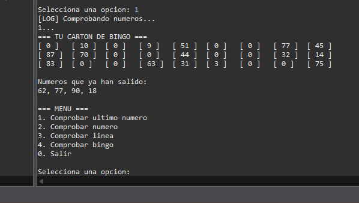
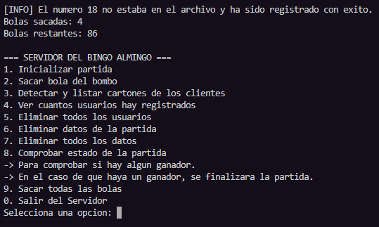

# Almingo - Bingo

GitHub: [Bingo](https://github.com/RetoAlmi/Reto-Almingo-Bingo)

## Índice
1. [Estructura del proyecto](#estructura-del-proyecto)
2. [Sistema de archivos](#sistema-de-archivos)
3. [Funcionamiento del Cliente](#funcionamiento-del-cliente)
4. [Funcionamiento del Servidor](#funcionamiento-del-servidor)
5. [Requisitos del Sistema](#requisitos-del-sistema)

### 1. Estructura del proyecto:
A continuación se mostrará la estructura utilizada en el proyecto:
src/
├── servidor/
│ 	 └── ServidorBingo.java
├── cliente/
│ 	 ├── DatosPregunta.java
│ 	 ├── JuegoPreguntas.java
│ 	 └── ClienteBingo.java
├── README.md
├── clienteFoto.png
├── servidorFoto.png
├── preguntas.txt
└── Video Completo.mp4

Para establecer conexión:
Usuario: Alumnado
Contraseña: Almi26-27

---

### 2. Sistema de archivos:

Los archivos han sido separados en diferentes paquetes por su funcionalidad y organización.

En el caso de los archivos para el cliente (la persona que jugaría al bingo), los archivos han sido agregados al paquete cliente para tener organizado todo lo que sería usado por parte del cliente mediante `package cliente;`:

**Paquete cliente:**

> ClienteBingo.java

> DatosPregunta.java

> JuegoPreguntas.java

Para el caso del archivo del servidor (el programa que se ejecutaría para controlar la partida), ha sido agregado al paquete servidor mediante `package servidor;`:

**Paquete servidor:**

> ServidorBingo.java

---

### 3. Funcionamiento del Cliente:

En el cliente, hemos dividido el funcionamiento principal de las preguntas para poder tenerlo por separado.


#### 3.1. Funcionamiento principal:

El funcionamiento principal del código sería el archivo ClienteBingo.java.

*[ClienteBingo.java](https://www.google.com/search?q=https://github.com/RetoAlmi/Reto-Almingo-Bingo/blob/main/src/cliente/ClienteBingo.java)*

**Características principales:**
* Identificación Única de Sesión (UID): Al iniciar el programa, se le solicita al usuario que introduzca su nombre. Al hacer esto, el programa genera automáticamente un UID para poder tener varios usuarios con el mismo nombre y evitar el problema de tener más de un usuario con el mismo nombre.
* Generación del Cartón del Bingo: Después de crear el usuario, automáticamente un código genera el cartón del usuario de 3x9 con 5 números generados aleatoriamente entre el 1 y el 90 en cada fila. Para marcar los números vacíos, se utiliza el número 0 ya que nunca aparece en el bingo.
* Sincronización de Ficheros: El programa accede a la ruta compartida en `\\DESKTOP-V7J205P\Reto-Almingo-Bingo` para crear dentro de la carpeta "usuarios" una carpeta nueva con el nombre y UID del jugador, incluyendo dentro los archivos carton.txt, estadisticas.txt, preguntasHechas.txt, resultado.txt y uid.txt.
* Sistema de Marcado de Números: En nuestro sistema de marcado de números, utilizamos el símbolo "-" por delante del número para marcar los números que ya han salido en el bingo.
* Herramientas de Administrador: Incluimos una herramienta que nos permite hacer una comprobación masiva de todos los números que han salido en el bingo.




**Cómo funciona:**
El funcionamiento del programa es simple:
1. El programa pide nuestro nombre; con esto genera los archivos del usuario y su UID.
2. Después de eso, el programa muestra el cartón del usuario, seguido de los números sacados del bingo (en el caso de que ya se haya sacado algún número) y por último aparece el menú de opciones.
3. En el menú, aparecen 5 opciones:
3.1. La primera sería comprobar el último número: En esta opción simplemente comprueba si han salido nuevos números.
3.2. En la segunda opción, el usuario comprueba si tiene un número en el cartón, introduciendo el número de forma manual.
3.3. En la tercera opción, se comprueba si se ha realizado una línea. En el caso de tener línea, se muestra la pregunta.
3.4. En la cuarta opción, se comprueba si el usuario ha completado el bingo. En el caso de haberlo completado, se muestra una pregunta final y al responderla se finaliza la partida y muestra las estadísticas del usuario.
3.5. En la quinta opción, se le da al usuario la posibilidad de salir de la partida.
3.6. En la sexta opción, es la opción de administrador mencionada anteriormente, por lo que permanece oculta.


**Utilización de los archivos:**

* carton.txt: Aquí se guarda el cartón completo del jugador y los números marcados.
* estadisticas.txt: Aquí se guardan las estadísticas al finalizar la partida.
* preguntasHechas.txt: Aquí se guardan cuántas preguntas se han respondido de forma correcta e incorrecta.
* resultado.txt: En este archivo se agrega el texto "Victoria", el nombre del jugador y su UID cuando finaliza para avisar al servidor que se ha terminado la partida.
* uid.txt: En este archivo aparece en la primera línea el número UID del usuario y, en la segunda línea, el nombre del jugador.
  

#### 3.2. Funcionamiento de las preguntas:

Las preguntas las realizamos en códigos aparte.
*[DatosPregunta.java:](https://www.google.com/search?q=https://github.com/RetoAlmi/Reto-Almingo-Bingo/blob/main/src/cliente/DatosPregunta.java)*
El archivo DatosPregunta.java sirve para preparar las variables, llenarlas con las preguntas, respuestas y respuesta correcta para después comunicarse con el otro programa.
*[JugarPreguntas.java:](https://www.google.com/search?q=https://github.com/RetoAlmi/Reto-Almingo-Bingo/blob/main/src/cliente/JugarPreguntas.java)*
Después, el archivo JugarPreguntas.java es el código que lee las preguntas y las divide en partes, guardando cada opción en una variable diferente para tener las opciones de las preguntas separadas.
*[ClienteBingo.java:](https://www.google.com/search?q=https://github.com/RetoAlmi/Reto-Almingo-Bingo/blob/main/src/cliente/ClienteBingo.java)*
Para acceder a las preguntas del bingo, llamamos a la función de JugarPreguntas.java. Al hacer esto, el programa devolverá un booleano TRUE en el caso de que sea correcta la respuesta, y en el caso de que sea errónea devolverá FALSE.
Para conectar ClienteBingo.java con JugarPreguntas.java utilizaremos el siguiente código:

  
```java
Scanner sc =  new  Scanner(System.in);
JuegoPreguntas juego =  new  JuegoPreguntas();
juego.lanzarPregunta(sc);
```

---

### 4. Funcionamiento del Servidor:

En el servidor, controlamos el funcionamiento de la partida completa.

#### 4.1. Qué podemos hacer:

En el menú del servidor, tenemos diferentes opciones para controlar distintas acciones:
* En la primera opción, podemos iniciar una partida nueva.
* En la segunda opción, sacamos números uno a uno de forma manual.
* En la tercera opción, detectamos los clientes y listamos los cartones para visualizarlos.
* En la cuarta opción, vemos cuántos usuarios hay registrados en la partida.
* En la quinta opción, eliminamos los archivos de todos los jugadores.
* En la sexta opción, eliminamos los archivos de la partida.
* En la séptima opción, eliminamos el estado de la partida donde aparece si alguien ha ganado la partida.
* En la octava opción, eliminamos los archivos de todos los jugadores y los datos de la partida.
* En la novena opción, comprobamos el estado de la partida para comprobar si hay algún ganador.
* En la décima opción, sacamos todos los números.
* En la undécima opción, salimos/cerramos el servidor.


#### 4.2. Archivos generados y sus funciones:

Por parte del servidor, se generan diferentes archivos .txt para guardar diferentes datos:
* partida.txt: Almacena en orden de aparición todas las bolas cantadas por el servidor (una por línea). Sirve para que los clientes sepan qué números han salido.
* totalBolas.txt: Fichero de contadores rápidos. Contiene exactamente dos líneas: la primera indica el número total de *bolas sacadas* hasta el momento, y la segunda las *bolas restantes* hasta el momento (partiendo de 90).
* estadoPartida.txt: Archivo de auditoría y registro de ganadores. Si el servidor detecta mediante la opción correspondiente que un jugador ha ganado (`resultado.txt`), escribe en este archivo un bloque detallando el ganador, la sesión y los datos del ganador.



---


### 5. Requisitos del Sistema

*  **Java Development Kit (JDK):** Versión 8 o superior.
*  **Java Development Kit (JDK) Recomendado:** Versión 21 o superior.
*  **Entorno de Red:** Acceso a la ruta de red compartida configurada en la constante `RUTA_COMPARTIDA`:
```java
public  static  final  String RUTA_COMPARTIDA =  "\\\\DESKTOP-V7J205P\\Reto-Almingo-Bingo";
```